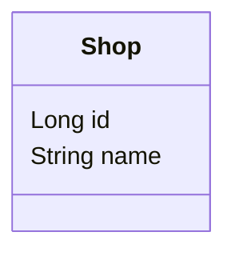
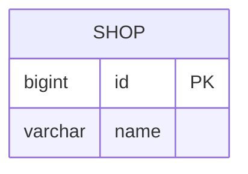

# Mini-Shopify

[](https://github.com/JacobA31/Mini-Shopify/actions/workflows/ci-cd.yml)

SYSC 4806 term project: a small e-commerce platform built with Spring MVC.

- **Live app:** _TBD (add the Azure URL once deployed)_
- **Kanban board:** _TBD (add the GitHub Projects link)_
- **Architecture:** [`docs/architecture.md`](docs/architecture.md)
- **How we work:** [`CONTRIBUTING.md`](CONTRIBUTING.md)

## About

Merchants create a shop by filling in a form with the shop's name, its categories/tags, and other details.
They then upload products with a description, picture, and inventory count. Customers find a shop by
name or by category/tag, browse its product catalog, add one or more products to a shopping cart, and
check out. Purchases are simulated, but they can never exceed the available inventory.

## Team

| Name | GitHub | Main area |
|------|--------|-----------|
|      |        |           |
|      |        |           |
|      |        |           |
|      |        |           |

## Running locally

Requires JDK 17+. Maven is not required; the wrapper downloads it.

```bash
./mvnw spring-boot:run     # http://localhost:8080
./mvnw verify              # compile, run tests, and build target/mini-shopify.jar
java -jar target/mini-shopify.jar
```

## Milestones

| Milestone           | Demo date | Goal                                              |
|---------------------|-----------|---------------------------------------------------|
| 1: Early prototype  | Nov 12    | One use case working end to end; CI + Azure live  |
| 2: Alpha release    | Nov 26    | Several related features usable together          |
| 3: Final demo       | Dec 10    | Feature-complete, no dangling links               |

## Current state

_Keep this in sync with the Kanban board before every milestone._

**Sprint 1 (in progress)**

- Done: project template (Spring Boot app skeleton, layered package structure, example tests)
- Done: CI pipeline (build and test on every PR and push to `main`)
- To do: Azure Web App setup (the deploy workflow is ready and waiting for credentials)

## Plan for next sprint

_To be agreed by the team and turned into issues on the board. See the suggested split in
[`docs/architecture.md`](docs/architecture.md#suggested-work-split)._

## Models (UML class diagram)

_No entities yet. When the first `@Entity` is merged, replace this paragraph with a Mermaid
`classDiagram` (GitHub renders it) that shows **only the classes in `com.minishopify.model`**.
Keep it in sync with the code in every PR that changes an entity._

<!--

-->

## Database schema

_No tables yet. The schema is generated by Hibernate from the entities. To see it, set
`spring.jpa.show-sql=true` and read the `create table` statements in the log, or open the H2 console
at http://localhost:8080/h2-console. IntelliJ's database tool can also draw the diagram. Document it here
as a Mermaid `erDiagram`, including join tables and foreign keys, and note which ORM patterns they
correspond to._

<!--

-->
