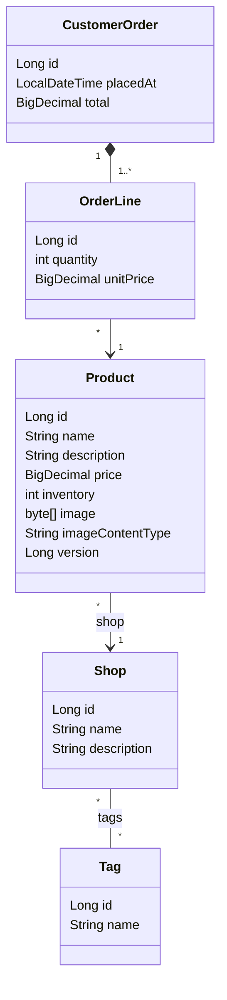
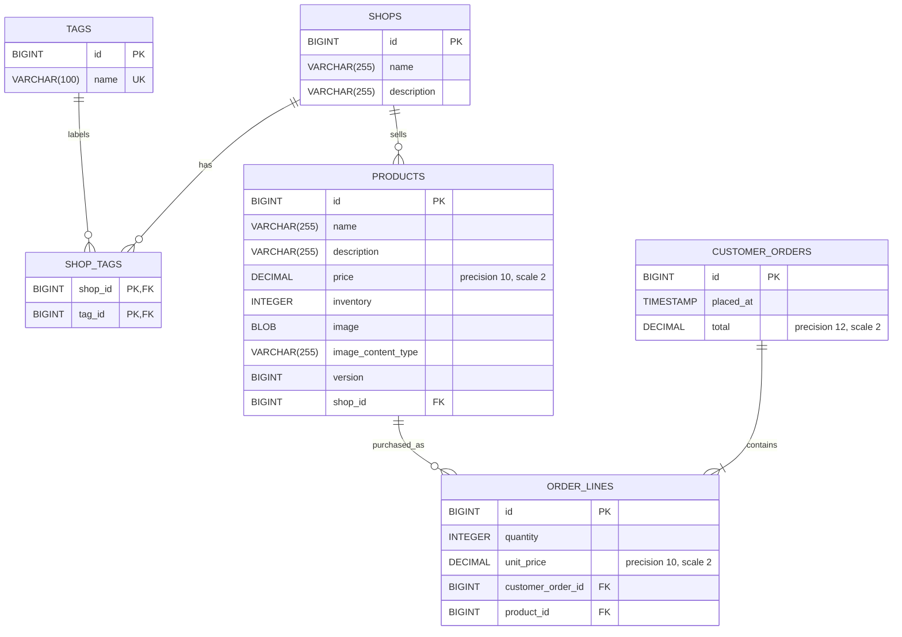

# Mini-Shopify

[](https://github.com/JacobA31/Mini-Shopify/actions/workflows/ci-cd.yml)

SYSC 4806 term project: a small e-commerce platform built with Spring MVC.

- **Live app:** https://mini-shopify-hhamccftdqg3fegq.canadacentral-01.azurewebsites.net/
- **Kanban board:** [Mini-Shopify Kanban](https://github.com/users/JacobA31/projects/4) (columns: Backlog, In progress, Completed)
- **Sprints:** [milestones](https://github.com/JacobA31/Mini-Shopify/milestones), one per sprint
- **Architecture:** [`docs/architecture.md`](docs/architecture.md)
- **How we work:** [`CONTRIBUTING.md`](CONTRIBUTING.md)

## About

Merchants create a shop by filling in a form with the shop's name, its categories/tags, and other details.
They then upload products with a description, picture, and inventory count. Customers find a shop by
name or by category/tag, browse its product catalog, add one or more products to a shopping cart, and
check out. Purchases are simulated, but they can never exceed the available inventory.

## Team

| Name              | GitHub                                              | Main area                   |
|-------------------|-----------------------------------------------------|-----------------------------|
| Ihsan Jacob Aydin | [JacobA31](https://github.com/JacobA31)             | Repo setup, CI/CD, Azure    |
| Fareed El Bokl    | [FareedElbokl](https://github.com/FareedElbokl)     | Shops                       |
| Radhe Patel       | [radhepatel55](https://github.com/radhepatel55)     | Products                    |
| Mahdi Bouakline   | [BouaklineMahdi](https://github.com/BouaklineMahdi) | Shop catalog                |
| Tabia Farid       | [tabiafarid](https://github.com/tabiafarid)         | Search                      |

## Running locally

Requires JDK 17+. Maven is not required; the wrapper downloads it.

```bash
./mvnw spring-boot:run     # http://localhost:8080
./mvnw verify              # compile, run tests, and build target/mini-shopify.jar
java -jar target/mini-shopify.jar
```

Locally the database is in memory and starts with a few demo shops and products. On Azure it is an
H2 file that survives restarts and redeploys. The schema comes from the Flyway migrations in
`src/main/resources/db/migration`: **if you change an entity, add a migration**
(see [CONTRIBUTING.md](CONTRIBUTING.md#changing-the-database-schema)).

### End-to-end browser tests (Playwright)

The Java tests never run JavaScript or click through pages in a browser,however, the Playwright tests in
`e2e/` do. They need Node 22 or newer.

```bash
npm ci                       # once, and after package.json changes
npx playwright install       # once: downloads Chromium, Firefox, and WebKit
./mvnw package -DskipTests   # build target/mini-shopify.jar, which Playwright starts on :8080
npm run test:e2e             # run the tests in all three browsers
npm run test:e2e:ui          # UI mode: pick tests, watch them run, step through each action
npm run typecheck            # check the tests' TypeScript for mistakes, without running them
```

If the app is already running on port 8080 (e.g. `./mvnw spring-boot:run`), Playwright uses it
instead of starting the JAR, so restart it after changing code. See
[CONTRIBUTING.md](CONTRIBUTING.md#client-side-tests) for writing tests and the Jasmine unit tests.

## Milestones

| Milestone           | Demo date | Goal                                              |
|---------------------|-----------|---------------------------------------------------|
| 1: Early prototype  | Nov 12    | One use case working end to end; CI + Azure live  |
| 2: Alpha release    | Nov 26    | Several related features usable together          |
| 3: Final demo       | Dec 10    | Feature-complete with login, no dangling links    |

## Current state

_Summarised from the [Kanban board](https://github.com/users/JacobA31/projects/4) on 2026-11-23.
Keep this in sync with the board before every milestone._

**Sprint 2 ([Sprint 2 – Alpha](https://github.com/JacobA31/Mini-Shopify/milestone/2), demo Nov 26):**
All 5 planned features completed and deployed. 138 tests pass in CI.

| Column        | Issue                                                                                                                    | Owner          |
|---------------|--------------------------------------------------------------------------------------------------------------------------|----------------|
| Completed     | [#19](https://github.com/JacobA31/Mini-Shopify/issues/19) Shopping cart kept in the session: add, view, change quantity, remove | BouaklineMahdi |
| Completed     | [#21](https://github.com/JacobA31/Mini-Shopify/issues/21) Keep data on Azure across restarts, and seed demo shops and products | JacobA31       |
| Completed     | [#23](https://github.com/JacobA31/Mini-Shopify/issues/23) Product pictures: upload one with each product and show it in the catalog | radhepatel55   |
| Completed     | [#24](https://github.com/JacobA31/Mini-Shopify/issues/24) Merchant edits a shop and its products                         | tabiafarid     |
| Completed     | [#25](https://github.com/JacobA31/Mini-Shopify/issues/25) Checkout in one transaction that checks and decrements inventory | FareedElbokl   |

**Sprint 1 ([Sprint 1 – Prototype](https://github.com/JacobA31/Mini-Shopify/milestone/1), demo Nov 12):**
All 9 issues completed: project setup, CI/CD and Azure ([#3](https://github.com/JacobA31/Mini-Shopify/issues/3)–[#6](https://github.com/JacobA31/Mini-Shopify/issues/6)),
create a shop ([#7](https://github.com/JacobA31/Mini-Shopify/issues/7)), add products ([#8](https://github.com/JacobA31/Mini-Shopify/issues/8)),
search shops ([#9](https://github.com/JacobA31/Mini-Shopify/issues/9)), view a catalog ([#10](https://github.com/JacobA31/Mini-Shopify/issues/10)),
and integration tests for every feature ([#16](https://github.com/JacobA31/Mini-Shopify/issues/16)).

**What works today:**

- **Merchants** create a shop with a name, description, and tags, add products with a description,
  price, inventory, and an optional picture (JPEG, PNG, GIF, or WebP, up to 2 MB), and edit the shop and
  its products afterwards (including replacing or removing the picture).
- **Customers** search shops by name or tag, browse a shop's catalog with pictures, and put products in a
  cart kept in their session. They can change quantities or remove items, then check out.
- **Checkout** runs in one transaction: it re-reads inventory, rejects anything out of stock, saves the
  order with each item's price, decrements inventory, and shows an order confirmation. If any item fails,
  nothing changes. `@Version` on `Product` stops two checkouts from both buying the last item.
- **Data survives** deploys and restarts on Azure (H2 file + Flyway migrations), and an empty database is
  seeded with four demo shops and their products.
- Every feature has unit, controller, and integration tests. CI runs them on every pull request and
  push, and every push to `main` deploys to the
  [live app](https://mini-shopify-hhamccftdqg3fegq.canadacentral-01.azurewebsites.net/).

**Known gaps (going into Sprint 3):**

- There is no login, so anyone can create or edit any shop.
- After leaving the *Shop created* page, a merchant has no link back to their shop's details,
  product list, or edit pages: those pages can only be reached by typing the URL.
- The home page only shows shops after a search. There is no way to browse all shops.
- The demo products have no pictures, and products without a picture show no placeholder.
- Merchants can't see the orders placed in their shop.

## Plan for next sprint

**Sprint 3 ([Sprint 3 – Final](https://github.com/JacobA31/Mini-Shopify/milestone/3), Nov 26 – Dec 10).**
Goal for the final demo: merchants and customers log in. A merchant manages only their own shops and sees
the orders placed in them, and a customer sees their past orders. Every page can be reached from a link,
and there are no links to unfinished features.

| Work item                                                                                                  | Owner          | Depends on |
|------------------------------------------------------------------------------------------------------------|----------------|------------|
| Login and registration with Spring Security: `MERCHANT` and `CUSTOMER` roles, a `UserAccount` entity, and a migration | JacobA31       | —          |
| Shops belong to the merchant who created them; only the owner can edit a shop or its products (403 page otherwise) | tabiafarid     | Login      |
| Merchant dashboard: *My shops* with links to each shop's details, products, and edit pages, plus the orders placed in each shop | FareedElbokl   | Login, owner |
| Customer order history: link orders to the customer who placed them, and add a *My orders* page with each order's details | BouaklineMahdi | Login      |
| Pictures for the demo products, a placeholder when a product has no picture, and a product details page | radhepatel55   | —          |
| Home page lists all shops (sorted by name) and lets customers filter by tag, as well as search              | tabiafarid     | —          |
| UI polish: consistent layout and navigation, no orphan pages or dangling links, clear error messages        | everyone       | —          |
| Final pass: README, UML, DB schema, and `docs/architecture.md` match the code; demo script for Dec 10      | JacobA31       | everything |

Each row becomes an issue in the Sprint 3 milestone. Every team member deploys at least once a week.

**Order of work:** login is first because three items depend on it, so it should be merged by
**Nov 30**. Until then, the other owners work on the parts that don't need it (pages, services, tests)
and use a hard-coded user in tests. Login, shop owners, and order history each change the schema, so
**coordinate migration numbers** (V2, V3, V4, in the order the PRs merge): rename yours if someone merges
the same number first (see [CONTRIBUTING.md](CONTRIBUTING.md#changing-the-database-schema)).

**Stretch goals if time allows:** search products across all shops, show "only N left" on low-stock
products, and "add to cart" without a page reload. Before the demo, check how long the live app takes
to wake up: the first request took about 40 s on Nov 23. If it is still that slow, move the App Service
to the Basic B1 plan.

## Models (UML class diagram)



## Database schema

Created by the Flyway migrations in `src/main/resources/db/migration` (Flyway's own
`flyway_schema_history` table is not shown).



The relationship lines above show the foreign-key links between tables. `SHOP_TAGS` has a composite
primary key made from `shop_id` and `tag_id`.

`ORDER_LINES` records the quantity and price of each product at checkout. The `@Version` field on
`Product` lets Hibernate detect concurrent inventory updates and prevent selling more than is in stock.
