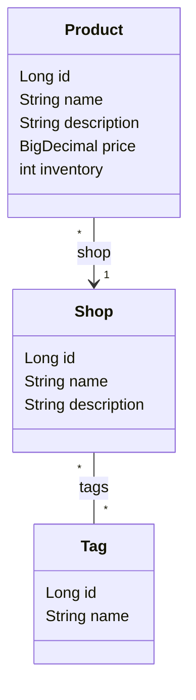
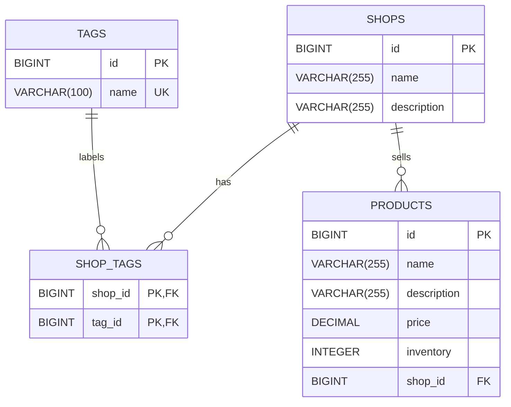

# Mini-Shopify

[](https://github.com/JacobA31/Mini-Shopify/actions/workflows/ci-cd.yml)

SYSC 4806 term project: a small e-commerce platform built with Spring MVC.

- **Live app:** https://mini-shopify-hhamccftdqg3fegq.canadacentral-01.azurewebsites.net/
- **Kanban board:** [Mini-Shopify Kanban](https://github.com/users/JacobA31/projects/4) (columns: Backlog, In progress, Completed)
- **Sprints:** [milestones](https://github.com/JacobA31/Mini-Shopify/milestones), one per sprint
- **Architecture:** [`docs/architecture.md`](docs/architecture.md)
- **How we work:** [`CONTRIBUTING.md`](CONTRIBUTING.md)

## About

Merchants create a shop by filling in a form with the shop's name, its categories/tags, and other details.
They then upload products with a description, picture, and inventory count. Customers find a shop by
name or by category/tag, browse its product catalog, add one or more products to a shopping cart, and
check out. Purchases are simulated, but they can never exceed the available inventory.

## Team

| Name              | GitHub                                              | Main area                   |
|-------------------|-----------------------------------------------------|-----------------------------|
| Ihsan Jacob Aydin | [JacobA31](https://github.com/JacobA31)             | Repo setup, CI/CD, Azure    |
| Fareed El Bokl    | [FareedElbokl](https://github.com/FareedElbokl)     | Shops                       |
| Radhe Patel       | [radhepatel55](https://github.com/radhepatel55)     | Products                    |
| Mahdi Bouakline   | [BouaklineMahdi](https://github.com/BouaklineMahdi) | Shop catalog                |
| Tabia Farid       | [tabiafarid](https://github.com/tabiafarid)         | Search                      |

## Running locally

Requires JDK 17+. Maven is not required; the wrapper downloads it.

```bash
./mvnw spring-boot:run     # http://localhost:8080
./mvnw verify              # compile, run tests, and build target/mini-shopify.jar
java -jar target/mini-shopify.jar
```

## Milestones

| Milestone           | Demo date | Goal                                              |
|---------------------|-----------|---------------------------------------------------|
| 1: Early prototype  | Nov 12    | One use case working end to end; CI + Azure live  |
| 2: Alpha release    | Nov 26    | Several related features usable together          |
| 3: Final demo       | Dec 10    | Feature-complete, no dangling links               |

## Current state

_Summarised from the [Kanban board](https://github.com/users/JacobA31/projects/4) on 2026-11-03.
Keep this in sync with the board before every milestone._

**Sprint 1 ([Sprint 1 – Prototype](https://github.com/JacobA31/Mini-Shopify/milestone/1), demo Nov 12):**
4 of 8 issues completed (the project setup). The 4 feature issues are assigned and in the backlog.

| Column      | Issue                                                                                                         | Owner          |
|-------------|---------------------------------------------------------------------------------------------------------------|----------------|
| Completed   | [#3](https://github.com/JacobA31/Mini-Shopify/issues/3) CI: build and test on every PR and push               | JacobA31       |
| Completed   | [#4](https://github.com/JacobA31/Mini-Shopify/issues/4) Project skeleton with layered packages                | JacobA31       |
| Completed   | [#5](https://github.com/JacobA31/Mini-Shopify/issues/5) Deploy to Azure from CI                               | JacobA31       |
| Completed   | [#6](https://github.com/JacobA31/Mini-Shopify/issues/6) Repo setup: collaborators and branch protection       | JacobA31       |
| Backlog     | [#7](https://github.com/JacobA31/Mini-Shopify/issues/7) Create a shop with a name, description, and tags      | FareedElbokl   |
| Backlog     | [#8](https://github.com/JacobA31/Mini-Shopify/issues/8) Add products with a description, price, and inventory | radhepatel55   |
| Backlog     | [#9](https://github.com/JacobA31/Mini-Shopify/issues/9) Search shops by name or tag                           | tabiafarid     |
| Backlog     | [#10](https://github.com/JacobA31/Mini-Shopify/issues/10) View a shop's product catalog                       | BouaklineMahdi |

**What works today:** the Spring Boot skeleton builds, and CI runs the tests on every pull request and
every push to `main`. Every push to `main` is also deployed automatically to the
[live app](https://mini-shopify-hhamccftdqg3fegq.canadacentral-01.azurewebsites.net/) on Azure.
No shop features are merged yet, so the live app shows only the home page.

## Plan for next sprint

**Sprint 2 ([Sprint 2 – Alpha](https://github.com/JacobA31/Mini-Shopify/milestone/2), Nov 12 – Nov 26).**
Goal for the alpha demo: a customer can find a shop, put several of its products in a cart, and check
out, and a purchase can never take more than the available inventory.

| Work item                                                                         | Owner          |
|-----------------------------------------------------------------------------------|----------------|
| Finish anything left over from Sprint 1                                           | issue owners   |
| Product pictures: upload one with each product and show it in the catalog         | radhepatel55   |
| Shopping cart kept in the session: add, view, change quantity, remove             | BouaklineMahdi |
| Checkout in one transaction that checks and decrements inventory                  | FareedElbokl   |
| Keep data on Azure across restarts, and seed demo shops and products              | JacobA31       |
| Merchant edits a shop and its products                                            | tabiafarid     |
| Update the UML class diagram and DB schema below in every PR that changes an entity | everyone     |

Each row becomes an issue in the Sprint 2 milestone. Every team member deploys at least once a week.

**Sprint 3 (Nov 26 – Dec 10, tentative):** order confirmation page, merchant/customer login if time
allows, UI polish, and no links to unfinished features.

## Models (UML class diagram)



## Database schema


