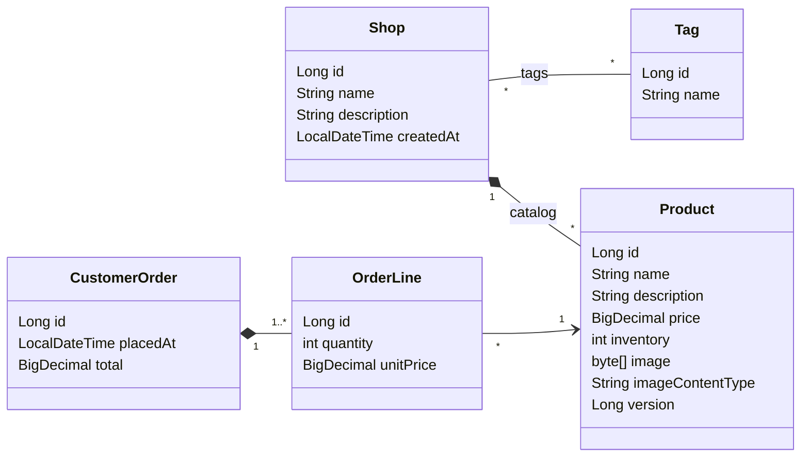

# Architecture

This document describes how the code is organised and the design we are aiming for.
The domain model below is a **proposal** for the team to discuss; nothing in it is
implemented yet. The README's UML and DB schema sections describe what actually exists.

## Tech stack

| Concern         | Choice                                   | Why                                                    |
|-----------------|------------------------------------------|--------------------------------------------------------|
| Language        | Java 17                                  | LTS, supported by Spring Boot 4 and Azure App Service  |
| Framework       | Spring Boot 4.1 (Spring MVC)             | Required by the course                                 |
| Views           | Thymeleaf (server-side rendered HTML)    | Fits Spring MVC; no separate frontend build            |
| Persistence     | Spring Data JPA + Hibernate              | ORM generates the schema from our `@Entity` classes    |
| Database        | H2 (in-memory)                           | Zero setup; see [Open decisions](#open-decisions)      |
| Build           | Maven (via `./mvnw` wrapper)             | `pom.xml` in the root, as required                     |
| CI/CD           | GitHub Actions → Azure App Service       | Test every PR, deploy every merge to `main`            |
| Tests           | JUnit 5, Mockito, MockMvc, AssertJ       | Included in the Spring Boot test starters              |

## Layers

A classic layered MVC architecture. Each layer only calls the one directly below it.

```mermaid
flowchart LR
    B[Browser] -->|HTTP| C[controller<br/>@Controller]
    C -->|model attributes| V[templates<br/>Thymeleaf views]
    C --> S[service<br/>@Service, @Transactional]
    S --> R[repository<br/>Spring Data JPA]
    R --> DB[(H2 database)]
    S -.uses.-> M[model<br/>@Entity]
    R -.persists.-> M
```

## Package layout

```
src/main/java/com/minishopify/
├── MiniShopifyApplication.java   Spring Boot entry point
├── model/        @Entity classes. Source of the DB schema and the README UML diagram.
├── repository/   Spring Data JPA interfaces (ShopRepository, ProductRepository, ...)
├── service/      Use cases and business rules; @Transactional boundaries
├── controller/   @Controller classes: thin, call a service, return a view name
├── dto/          Form objects bound to HTML forms, with Bean Validation annotations
└── exception/    Custom exceptions + @ControllerAdvice error handling

src/main/resources/
├── application.properties
├── templates/    Thymeleaf views, one folder per feature (shops/, products/, cart/, ...)
│   └── fragments/layout.html   Shared <head>, header, and footer
└── static/       CSS, JS, images

src/test/java/com/minishopify/    Mirrors the main package structure
```

**Rules of thumb**

- **Controllers never touch repositories.** Go through a service. This keeps business rules
  (like inventory checks) in one testable place.
- **Business rules live in services**, not in controllers or templates.
- **Forms bind to DTOs**, not entities. The service maps DTO → entity.
- **One feature = files in several layers.** For example, "create a shop" touches
  `model/Shop`, `repository/ShopRepository`, `service/ShopService`, `dto/ShopForm`,
  `controller/ShopController`, and `templates/shops/new.html`. Because each feature gets its own
  files, people working on different features rarely hit merge conflicts.

## Proposed domain model

> Proposal only. Discuss and adjust it before implementing. When entities are implemented,
> the README's UML diagram must describe the real code.



Design notes:

- **Shop ↔ Tag is many-to-many**, so customers can search by category. The ORM creates a
  join table for it (with Spring Boot's naming strategy, a `Set<Tag> tags` field on `Shop`
  becomes a `shop_tags` table). Keep tag names unique and lowercase.
- **Shopping cart lives in the HTTP session** (a `@SessionScope` bean holding product ids and
  quantities), not in the database. Only a completed checkout is persisted as a `CustomerOrder`.
- **Checkout is one `@Transactional` service method**. It reloads each product, checks
  `quantity <= inventory`, decrements inventory, and saves the order. If any line fails, the
  whole checkout rolls back and the user sees an error (`InsufficientInventoryException`).
- **`@Version` on `Product`** (optimistic locking) prevents two simultaneous checkouts from
  both buying the last item.
- **`OrderLine.unitPrice`** stores the price at the time of purchase, so later price changes
  don't affect past orders.
- **Don't name an entity `Order`**: `ORDER` is a reserved SQL word and breaks the generated
  schema. Hence `CustomerOrder`.
- **Product images are stored in the database** (`@Lob byte[]`) and served by a controller
  endpoint such as `GET /products/{id}/image`. That avoids having to manage files on Azure.
- **Merchant/customer accounts** are not modelled yet. See open decisions.

## Testing strategy

| Kind                 | Annotation / tool                     | What it covers                          | Where                              |
|----------------------|---------------------------------------|-----------------------------------------|------------------------------------|
| Unit                 | Plain JUnit + Mockito                 | Service logic with mocked repositories  | `service/*ServiceTest`             |
| Web slice            | `@WebMvcTest` + `MockMvc`             | Controller routing, validation, views   | `controller/*ControllerTest`       |
| Persistence slice    | `@DataJpaTest`                        | Custom repository queries, mappings     | `repository/*RepositoryTest`       |
| Integration          | `@SpringBootTest` + `MockMvc`         | A full use case through all layers      | `*IntegrationTest`                 |

Every PR that adds behaviour should add tests. `./mvnw verify` runs all of them, locally and in CI.

## Open decisions

To decide as a team (record the outcome here):

1. **Persistence on Azure.** In-memory H2 loses all data on every deploy and restart.
   Options: (a) keep in-memory and seed demo data on startup with a `CommandLineRunner`;
   (b) H2 file stored on Azure's persistent `/home` disk
   (`spring.datasource.url=jdbc:h2:file:/home/data/minishopify` plus `ddl-auto=update` in an
   Azure-only profile); (c) Azure Database for PostgreSQL (more setup, costs credits).
2. **Authentication.** Start without login (anyone can create a shop or buy), then add
   Spring Security with `MERCHANT` and `CUSTOMER` roles if time allows. Adding login later
   means `Shop` gains an owner relationship.
3. **JavaScript.** Plain server-rendered forms first. Add small JS/`fetch` calls (e.g.
   "add to cart" without a page reload) only where it clearly improves the demo.

## Suggested work split

Four vertical slices. Each person owns one end to end (model → view → tests) and reviews the others:

| Slice                  | Scope                                                              |
|------------------------|--------------------------------------------------------------------|
| Shops                  | Create/edit shop form, tags/categories, shop page                  |
| Products               | Add/edit products with description, picture, price, and inventory  |
| Discovery              | Search shops by name and by tag, browse a shop's catalog           |
| Cart & checkout        | Session cart, checkout, inventory enforcement, order confirmation  |

Suggested milestone targets (adjust in the README's sprint plan):

- **Milestone 1, Nov 12 (prototype):** CI + Azure live; one use case end to end
  (e.g. a merchant creates a shop with tags and it appears in a list of shops).
- **Milestone 2, Nov 26 (alpha):** products with images and inventory, search by name/tag,
  browse a catalog, add to cart.
- **Milestone 3, Dec 10 (final):** checkout with inventory enforcement, polish, any stretch
  goals (login, persistence), and no dangling links.
