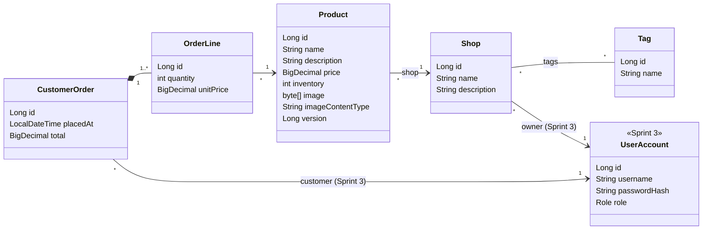

# Architecture

This document describes how the code is organised and the design decisions behind it.
The README's UML and DB schema sections describe exactly what is in the code today; the
domain model below also shows what Sprint 3 adds.

## Tech stack

| Concern         | Choice                                   | Why                                                    |
|-----------------|------------------------------------------|--------------------------------------------------------|
| Language        | Java 17                                  | LTS, supported by Spring Boot 4 and Azure App Service  |
| Framework       | Spring Boot 4.1 (Spring MVC)             | Required by the course                                 |
| Views           | Thymeleaf (server-side rendered HTML)    | Fits Spring MVC; no separate frontend build            |
| Persistence     | Spring Data JPA + Hibernate              | ORM maps our `@Entity` classes to tables               |
| Schema          | Flyway migrations (`db/migration`)       | Versioned schema changes that keep the live data       |
| Database        | H2: in memory locally, a file on Azure   | Zero setup; see [Open decisions](#open-decisions)      |
| Build           | Maven (via `./mvnw` wrapper)             | `pom.xml` in the root, as required                     |
| CI/CD           | GitHub Actions → Azure App Service       | Test every PR, deploy every merge to `main`            |
| Tests           | JUnit 5, Mockito, MockMvc, AssertJ       | Included in the Spring Boot test starters              |

## Layers

A classic layered MVC architecture. Each layer only calls the one directly below it.

```mermaid
flowchart LR
    B[Browser] -->|HTTP| C[controller<br/>@Controller]
    C -->|model attributes| V[templates<br/>Thymeleaf views]
    C --> S[service<br/>@Service, @Transactional]
    S --> R[repository<br/>Spring Data JPA]
    R --> DB[(H2 database)]
    S -.uses.-> M[model<br/>@Entity]
    R -.persists.-> M
```

## Package layout

```
src/main/java/com/minishopify/
├── MiniShopifyApplication.java   Spring Boot entry point
├── model/        @Entity classes. Must match the Flyway migrations; source of the README UML diagram.
├── repository/   Spring Data JPA interfaces (ShopRepository, ProductRepository, ...)
├── service/      Use cases and business rules; @Transactional boundaries
├── controller/   @Controller classes: thin, call a service, return a view name
├── dto/          Form objects bound to HTML forms, with Bean Validation annotations
├── exception/    Custom exceptions + @ControllerAdvice error handling
└── config/       Startup and configuration code (DemoDataSeeder)

src/main/resources/
├── application.properties          Settings for local runs and tests (in-memory H2)
├── application-azure.properties    Overrides for the live app (H2 file on /home)
├── db/migration/ Flyway migrations V1__..., V2__...: the DB schema (see CONTRIBUTING.md)
├── templates/    Thymeleaf views, one folder per feature (shops/, products/, cart/, ...)
│   └── fragments/layout.html   Shared <head>, header, and footer
└── static/       CSS, JS, images

src/test/java/com/minishopify/    Mirrors the main package structure
```

**Rules of thumb**

- **Controllers never touch repositories.** Go through a service. This keeps business rules
  (like inventory checks) in one testable place.
- **Business rules live in services**, not in controllers or templates.
- **Forms bind to DTOs**, not entities. The service maps DTO → entity.
- **One feature = files in several layers.** For example, "create a shop" touches
  `model/Shop`, `repository/ShopRepository`, `service/ShopService`, `dto/ShopForm`,
  `controller/ShopController`, and `templates/shops/new.html`. Because each feature gets its own
  files, people working on different features rarely hit merge conflicts.

## Domain model

> Sprint 1–2 entities are implemented. The entities and fields marked *Sprint 3* are planned
> (login and order history) and don't exist yet. When they are implemented, update the README's UML
> diagram and DB schema in the same PR.



Design notes:

- **Shop ↔ Tag is many-to-many**, so customers can search by category. The ORM creates a
  join table for it (with Spring Boot's naming strategy, a `Set<Tag> tags` field on `Shop`
  becomes a `shop_tags` table). Keep tag names unique and lowercase.
- **Shopping cart lives in the HTTP session** (a `@SessionScope` bean holding product ids and
  quantities), not in the database. Only a completed checkout is persisted as a `CustomerOrder`.
- **Checkout is one `@Transactional` service method**. It reloads each product, checks
  `quantity <= inventory`, decrements inventory, and saves the order. If any line fails, the
  whole checkout rolls back and the user sees an error (`InsufficientInventoryException`).
- **`@Version` on `Product`** (optimistic locking) prevents two simultaneous checkouts from
  both buying the last item.
- **`OrderLine.unitPrice`** stores the price at the time of purchase, so later price changes
  don't affect past orders.
- **Don't name an entity `Order`**: `ORDER` is a reserved SQL word and breaks the generated
  schema. Hence `CustomerOrder`.
- **Product images are stored in the database** (`@Lob byte[]`) and served by a controller
  endpoint such as `GET /products/{id}/image`. That avoids having to manage files on Azure.
- **Merchant/customer accounts** are planned for Sprint 3 as one `UserAccount` entity with a `role`
  (`MERCHANT` or `CUSTOMER`). See open decisions.
- **A merchant's orders** are found through `OrderLine → Product → Shop`, so `CustomerOrder` doesn't
  need a shop column. One order can contain products from several shops.

## Testing strategy

| Kind                 | Annotation / tool                     | What it covers                          | Where                              |
|----------------------|---------------------------------------|-----------------------------------------|------------------------------------|
| Unit                 | Plain JUnit + Mockito                 | Service logic with mocked repositories  | `service/*ServiceTest`             |
| Web slice            | `@WebMvcTest` + `MockMvc`             | Controller routing, validation, views   | `controller/*ControllerTest`       |
| Persistence slice    | `@DataJpaTest`                        | Custom repository queries, mappings     | `repository/*RepositoryTest`       |
| Integration          | `@SpringBootTest` + `MockMvc`         | A full use case through all layers      | `*IntegrationTest`                 |

Every PR that adds behaviour should add tests. `./mvnw verify` runs all of them, locally and in CI.

## Open decisions

To decide as a team (record the outcome here):

1. **Persistence on Azure.** ✅ *Decided in Sprint 2 (#21).* In-memory H2 lost all data on every
   deploy and restart. Options were: (a) keep in-memory and seed demo data on startup;
   (b) H2 file on Azure's persistent `/home` disk; (c) Azure Database for PostgreSQL.
   **Outcome: (b), plus seeding and Flyway.**
   - The `azure` profile (`application-azure.properties`, turned on by the App Service setting
     `SPRING_PROFILES_ACTIVE=azure`) uses `jdbc:h2:file:/home/data/minishopify`. Local runs and tests
     keep in-memory H2.
   - The schema is managed by Flyway migrations, with `ddl-auto=validate`. `ddl-auto=update` was
     rejected: on a database that keeps its data, it can't rename or drop columns, and it fails on
     new `not null` columns once tables have rows.
   - `DemoDataSeeder` adds demo shops and products on startup when there are no shops, so the live
     app is never empty. Turned off in tests (`minishopify.seed.enabled=false`).
   - Why not PostgreSQL: free, no extra Azure resource, and the same engine we use locally.
     Trade-off: H2 allows only one process to open the file, so the App Service must stay at one
     instance. If deploys start failing with `Database may be already in use`, revisit (c).
2. **Authentication.** *Planned for Sprint 3.* Sprints 1–2 had no login, so anyone can create
   or edit any shop. Sprint 3 adds Spring Security form login with a `UserAccount` entity and
   `MERCHANT` / `CUSTOMER` roles, with passwords stored as BCrypt hashes. `Shop` gains a required
   `owner`, and `CustomerOrder` gains a `customer`. Shops that already exist on the live database get the
   demo merchant as their owner in the migration, so `not null` can be added safely.
   Browsing, search, and the cart stay public. Creating and editing shops needs `MERCHANT`, and
   checkout needs `CUSTOMER`. Record the final choices here.
3. **JavaScript.** Plain server-rendered forms first. Add small JS/`fetch` calls (e.g.
   "add to cart" without a page reload) only where it clearly improves the demo.

## Work split

Each person owns a vertical slice end to end (model → view → tests) and reviews the others. The
current owners and the plan for each sprint are in the README's
[*Plan for next sprint*](../README.md#plan-for-next-sprint) section and the
[milestones](https://github.com/JacobA31/Mini-Shopify/milestones).

| Slice                  | Scope                                                              |
|------------------------|--------------------------------------------------------------------|
| Shops                  | Create/edit shop form, tags/categories, shop page, merchant dashboard |
| Products               | Add/edit products with description, picture, price, and inventory  |
| Discovery              | Search shops by name and by tag, browse a shop's catalog           |
| Cart & checkout        | Session cart, checkout, inventory enforcement, order confirmation and history |
| Platform               | CI/CD, Azure, persistence, login and security                      |
